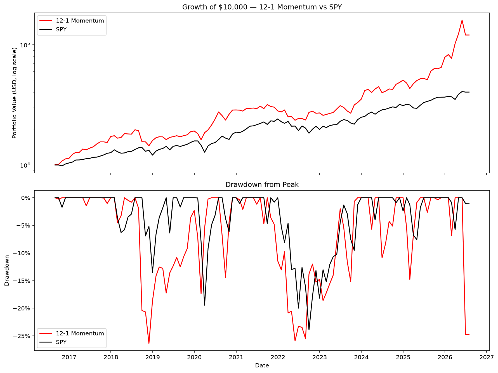

# momentum-backtest

A 12-1 momentum strategy backtested against SPY over ten years, with an honest accounting of why the result is better than it looks.



## The strategy

At each month-end, rank 100 large-cap stocks by their return from 12 months ago to 1 month ago, hold the top 10 in equal weight for the following month, then rebalance. The most recent month is excluded from the lookback because stocks tend to reverse at the one-month horizon.

## Results

| | 12-1 Momentum |
|---|---|
| Total return | 1,104% |
| CAGR | 28.5% |
| Annualized volatility | 28.0% |
| Sharpe ratio | 1.03 |
| Max drawdown | −26.4% |

**Do not believe this number.** A 28.5% CAGR is roughly double the market's over the same period, and no real momentum strategy earns that. The reason is in the universe, not the signal — see below.

## Scripts

- `01_buy_and_hold.py` — validates the backtest harness on SPY buy-and-hold, where the answer is already known, and cross-checks the monthly CAGR against the daily one
- `02_signal.py` — builds the 12-1 momentum signal and writes the monthly top-10 holdings to `data/rnk.csv`
- `03_backtest.py` — simulates the strategy, benchmarks it against SPY, and produces the tearsheet

## How to run

```
python -m venv .venv
source .venv/bin/activate
pip install -r requirements.txt
python 03_backtest.py
```

Run from the repo root. `02_signal.py` downloads eleven years of daily prices for 100 tickers and takes a few minutes; its output is committed, so `03_backtest.py` runs against the cached file.

## Why the result is inflated

**Survivorship, and worse.** The universe is the 100 largest S&P 500 companies *as of the date the universe file was built*. Applied backward to 2016, that means the strategy was only ever allowed to choose among companies that went on to become the largest in the index. The first month's top pick is AMD, which rose roughly 50× over the following decade — the backtest did not discover that, it was handed a list built from the outcome. Companies that failed, were acquired, or fell out of the index never appear at all. This alone probably explains most of the gap between 28.5% and what an honest test would show.

**No lookahead in the signal, at least.** The momentum value on any month-end uses only prices from that date and earlier, and the return it earns is the following month's. Both directions are enforced with an explicit shift. The universe is the flaw here, not the timing.

**Costs are a guess.** 0.2% is deducted per rebalance. The strategy replaces most of its ten holdings every month, and real slippage on that turnover could be higher.

**One market regime.** Ten years covering a long bull market, one pandemic crash, and one rate-driven drawdown. Momentum has historically suffered severe crashes during sharp reversals, and this window may not contain a representative one.

## Would I trade it?

No. Not because the code is wrong, but because the test can't distinguish a real edge from a universe built with hindsight. Fixing that requires point-in-time index membership — knowing who was in the S&P 500 on each historical date — which is what commercial datasets like CRSP exist to provide.

Educational project — not investment advice.
